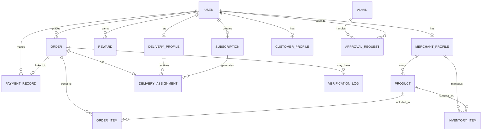

# Aasapure

Aasapure is a multi-role dairy logistics web application that connects **customers**, **merchants/farmers**, **delivery partners**, and **admins** in one system.

The project focuses on:

* daily milk delivery
* subscription-based ordering
* doorstep purity verification
* delivery tracking
* merchant inventory and earnings
* admin verification and approval workflows

This project is designed as a **real product-style web application**, not a static website.

---

## 1. Project Vision

Aasapure is built to solve the problem of unorganized milk delivery by creating a trusted digital platform where:

* customers can order milk easily
* merchants/farmers can manage stock and orders
* delivery partners can complete deliveries and verification
* admins can approve and monitor the ecosystem

The main differentiator of Aasapure is its **purity verification flow at the doorstep**, which makes the app unique compared to standard delivery platforms.

---

## 2. Core Product Idea

### Main concept

A customer selects milk or dairy products from nearby verified merchants/farmers. The merchant receives the order, the delivery partner picks up the product, and the product is delivered to the customer. At delivery time, the customer may request a purity check, and the delivery partner can log a verification result.

### Key product principles

* trust first
* simple daily usage
* subscription-centric ordering
* role-based experience
* transparent delivery flow
* scalable architecture

---

## 3. User Roles

Aasapure has four main roles.

### 3.1 Customer

The customer can:

* sign up and log in
* browse products
* add items to cart
* place one-time orders
* create subscriptions
* pause, resume, or edit subscriptions
* track orders
* view rewards
* view order history
* manage addresses and profile

### 3.2 Merchant / Farmer

The merchant can:

* register and wait for admin approval
* set up farm profile
* manage milk inventory
* add or update products
* accept or reject orders
* monitor subscriptions and demand
* view earnings
* track quality and freshness

### 3.3 Delivery Partner

The delivery partner can:

* register and wait for admin approval
* view assigned orders
* accept delivery tasks
* update delivery status
* perform or log purity verification
* view active route and delivery progress
* check earnings and history

### 3.4 Admin

The admin can:

* approve merchant registrations
* approve delivery partner registrations
* monitor orders and users
* manage complaints
* handle basic analytics and verification
* oversee the platform

---

## 4. MVP Scope

This project is being developed in phases. The first version should focus on a working end-to-end flow.

### MVP should include

* authentication and role-based login
* customer product browsing and checkout
* merchant inventory and order management
* delivery partner order workflow
* admin approval workflow
* subscription creation and control
* purity verification logging
* order tracking status flow
* basic rewards system
* payment simulation
* database persistence

### Later phase features

* fully live map tracking
* real payment gateway integration
* push notifications
* advanced analytics
* automated route optimization
* chat/support system

---

## 5. UI / UX Vision

The interface has already been designed in multiple screens. The design direction is:

* modern
* clean
* responsive
* trust-focused
* easy to understand
* consistent across all roles

### Visual style

* primary brand color: green
* white/light backgrounds
* soft cards and shadows
* clear typography
* consistent spacing
* easy button hierarchy

### UX goals

* one primary action per page
* minimal friction
* clear next step in every flow
* no cluttered dashboards
* role-specific user journeys

---

## 6. Existing Design Assets

The following UI groups have already been created and should be converted into working pages:

### Customer screens

* landing page
* login / signup
* customer dashboard
* shop / product listing
* product detail
* cart
* checkout
* order tracking
* subscription management
* rewards
* order history
* profile

### Merchant screens

* merchant dashboard
* onboarding / registration
* inventory management
* order management
* earnings
* farm profile
* product management
* subscription demand / forecast

### Delivery screens

* delivery dashboard
* active delivery details
* order queue
* route / tracking view
* purity verification
* earnings
* delivery history

### Admin screens

* admin dashboard
* approval queue
* user management
* order monitoring
* complaint handling
* analytics overview

---

## 7. Recommended Tech Stack

The stack should remain open-source and practical.

### Frontend

* React
* Vite
* TypeScript
* Tailwind CSS
* React Router
* Axios or Fetch API
* Socket.IO client or polling for live updates

### Backend

* Node.js
* NestJS
* TypeScript
* REST APIs
* Socket.IO or server-sent updates for demo real-time behavior

### Database

Use **PostgreSQL** instead of MongoDB.

#### Why PostgreSQL

* open source
* free to use
* reliable for relational data
* strong support for users, orders, subscriptions, and approvals
* easy to model relationships between customers, merchants, delivery partners, and orders

### ORM / Query Layer

* Prisma or TypeORM

### Optional tools

* Redis for queueing later
* JWT for auth
* bcrypt for password hashing
* Cloudinary or local storage for images
* Razorpay test mode later for payment demo

---

## 8. Why PostgreSQL Fits This Project Better

This project contains many connected entities:

* users
* roles
* merchant approvals
* products
* inventory
* orders
* subscriptions
* delivery tasks
* rewards
* payments
* verification logs

These are relational by nature. PostgreSQL is suitable because it supports:

* strong relations
* foreign keys
* transactions
* normalization
* clear auditing
* stable reporting

For this project, PostgreSQL is a stronger choice than a document-only database.

---

## 9. System Architecture

### High-level flow

1. customer signs up and logs in
2. customer browses products or creates a subscription
3. order is stored in the database
4. merchant receives the order
5. merchant accepts and prepares the product
6. delivery partner is assigned
7. delivery partner picks up the product
8. delivery partner updates status in transit
9. customer may request purity verification
10. delivery partner logs the result
11. delivery is completed
12. rewards and history are updated
13. admin can monitor the process

---

## 10. Functional Logic Flow

### 10.1 First-time merchant flow

* merchant opens the platform
* merchant registers with farm details
* merchant profile is marked as pending
* admin manually verifies the merchant
* once approved, the merchant can manage inventory and receive orders

### 10.2 First-time delivery partner flow

* delivery partner registers
* account is marked pending
* admin manually approves the account
* delivery partner then receives tasks

### 10.3 Customer ordering flow

* customer logs in
* customer browses products
* customer chooses milk type and quantity
* customer adds item to cart
* customer chooses delivery or subscription
* customer places order
* system stores order in the database
* merchant receives the order
* delivery partner handles delivery

### 10.4 Subscription flow

* customer selects a product
* customer sets quantity and frequency
* system stores a recurring subscription
* the app auto-generates future delivery tasks
* customer can pause/resume/edit subscription later

### 10.5 Purity verification flow

* customer requests purity verification at delivery
* delivery partner logs verification result
* system stores verification event in delivery history
* customer sees verified result

---

## 11. Data Model Overview

The system should store all critical actions in the database.

### Main entities

* users
* roles
* merchant_profiles
* delivery_profiles
* customer_profiles
* products
* inventory_items
* orders
* order_items
* subscriptions
* delivery_assignments
* verification_logs
* rewards
* payment_records
* notifications
* complaints
* approval_requests

---

## 12. ER Diagram



---

## 13. Main Modules

### 13.1 Customer Module

The customer module must include:

* home/dashboard
* product browsing
* product details
* cart
* checkout
* order tracking
* subscription management
* rewards
* order history
* notifications
* profile and addresses

### 13.2 Merchant Module

The merchant module must include:

* dashboard
* registration form
* farm profile
* inventory management
* product management
* order management
* earnings
* demand forecast
* quality / freshness indicators

### 13.3 Delivery Module

The delivery module must include:

* live dashboard
* order queue
* active delivery view
* route / map view
* purity verification
* delivery history
* earnings
* issue handling

### 13.4 Admin Module

The admin module must include:

* overview dashboard
* verification queue
* user management
* merchant approvals
* delivery approvals
* order monitoring
* complaints
* basic analytics

---

## 14. Backend Design

The backend should be separated into feature modules.

### Suggested backend modules

* auth
* users
* customers
* merchants
* deliveries
* orders
* products
* inventory
* subscriptions
* payments
* rewards
* notifications
* admin
* approvals
* verification

### Layering style

* controllers handle requests
* services handle business logic
* repositories/models handle database operations
* middleware handles auth and validation

---

## 15. API Flow

### Authentication APIs

* register
* login
* logout
* get profile
* role-based dashboard routing

### Customer APIs

* list products
* get product details
* create cart order
* create checkout order
* manage subscription
* get order history
* get reward status
* get notifications

### Merchant APIs

* create/update product
* update inventory
* list orders
* accept/reject orders
* get earnings
* get subscription demand

### Delivery APIs

* get assigned tasks
* accept delivery
* update delivery status
* log purity verification
* get earnings
* get delivery history

### Admin APIs

* approve merchant
* approve delivery partner
* list users
* list orders
* view complaints
* view analytics summary

### Payment APIs

* create payment intent or simulation record
* mark payment success
* mark payment failure
* store transaction history

---

## 16. Real-Time Behavior

The app should feel live even if fully advanced real-time features are added later.

### Real-time or simulated updates

* order status changes
* delivery progress updates
* merchant order acceptance
* subscription reminders
* reward unlock notifications
* admin approval status changes

### MVP implementation option

If live sockets are not ready, use polling or interval-based refresh for demo mode.

---

## 17. Payment Plan

For the initial build:

* use payment simulation
* show payment success and failure states
* store payment records

For later phase:

* integrate Razorpay test mode
* later move to production gateway if needed

---

## 18. Security and Validation

The app should include:

* role-based access control
* password hashing
* input validation
* protected routes
* approval states for merchants and delivery partners
* secure API patterns

---

## 19. Development Plan

The work should be implemented in stages.

### Stage 1

* set up frontend and backend structure
* connect routing
* load existing UI screens

### Stage 2

* build auth
* add database connection
* create user and role flows

### Stage 3

* build customer ordering flow
* connect cart and checkout
* store order data

### Stage 4

* build merchant inventory and order handling
* connect earnings and farm profile

### Stage 5

* build delivery workflow
* connect status updates and verification logs

### Stage 6

* build admin approvals and monitoring
* connect all dashboards

### Stage 7

* add payment simulation
* add notification logic
* add real-time updates

### Stage 8

* cleanup, testing, and deployment

---

## 20. Deployment Plan

### Frontend deployment

* build frontend for production
* deploy on Vercel or similar static hosting

### Backend deployment

* deploy backend on Render, Railway, or similar

### Database deployment

* use PostgreSQL hosted on a managed free/open-source-friendly service
* store credentials in environment variables

### Environment variables

* database URL
* JWT secret
* payment keys
* optional auth keys

---

## 21. Development Rules

* do not keep any page static
* every button should do something
* all forms should store or simulate data
* use shared UI components
* keep feature boundaries clear
* make debugging easy
* use version control with frequent commits
* keep rollback points after each stable milestone

---

## 22. Acceptance Criteria

The project is successful when:

* users can log in by role
* customer can order milk and view tracking
* merchant can manage inventory and orders
* delivery partner can update delivery status
* admin can approve accounts
* payment flow works in simulation
* data is saved in the database
* the UI remains consistent and usable

---

## 23. Final Project Statement

Aasapure is a full-stack dairy logistics platform built to provide trusted milk delivery through a structured multi-role system. It combines subscription-based milk delivery, doorstep purity verification, role-based operations, and order tracking into one unified product.

The project is intended to be:

* practical
* scalable
* easy to explain
* easy to demo
* easy to extend

---

## 24. Immediate Next Step for Development

1. convert UI screens into React pages
2. connect routing
3. build authentication and role-based access
4. connect PostgreSQL
5. implement order, merchant, and delivery APIs
6. add payment simulation
7. add real-time status updates
8. deploy

---

## 25. Notes for Codex

* keep code modular
* keep functions small
* keep file names descriptive
* separate feature logic by role
* prefer reusable components
* add comments only where helpful
* do not mix UI and backend concerns
* build for maintainability first, then polish

```

If you want the next step, I will turn this into a **cleaner Codex-ready version** with only the development-critical parts and no extra explanation.

```
